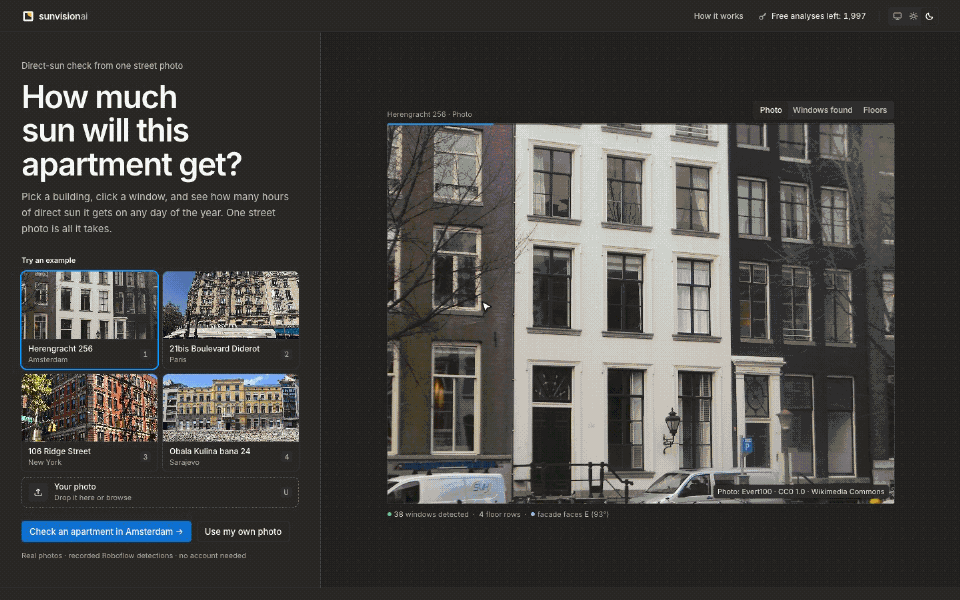
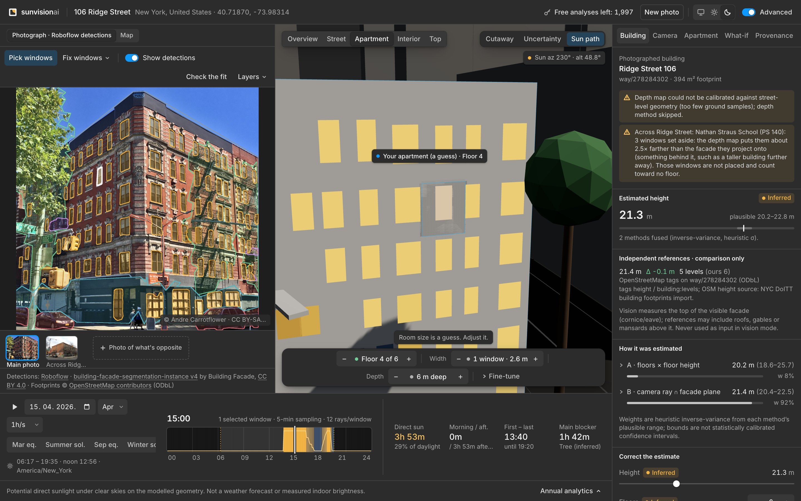
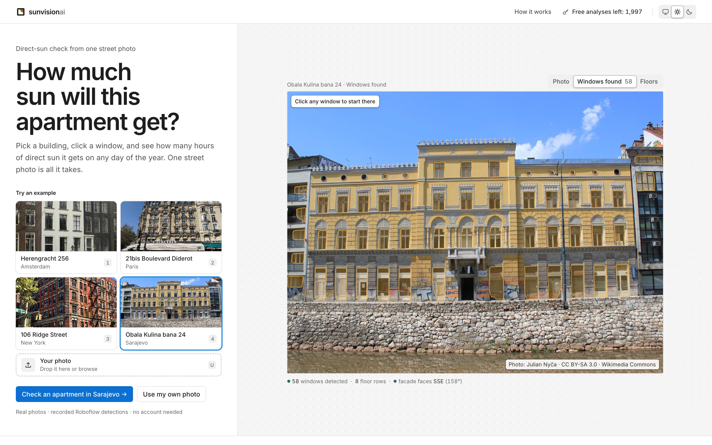
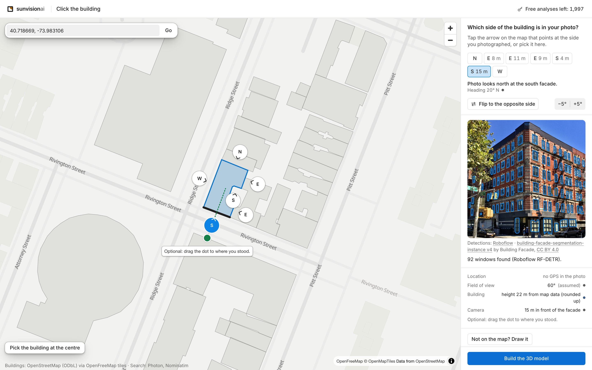
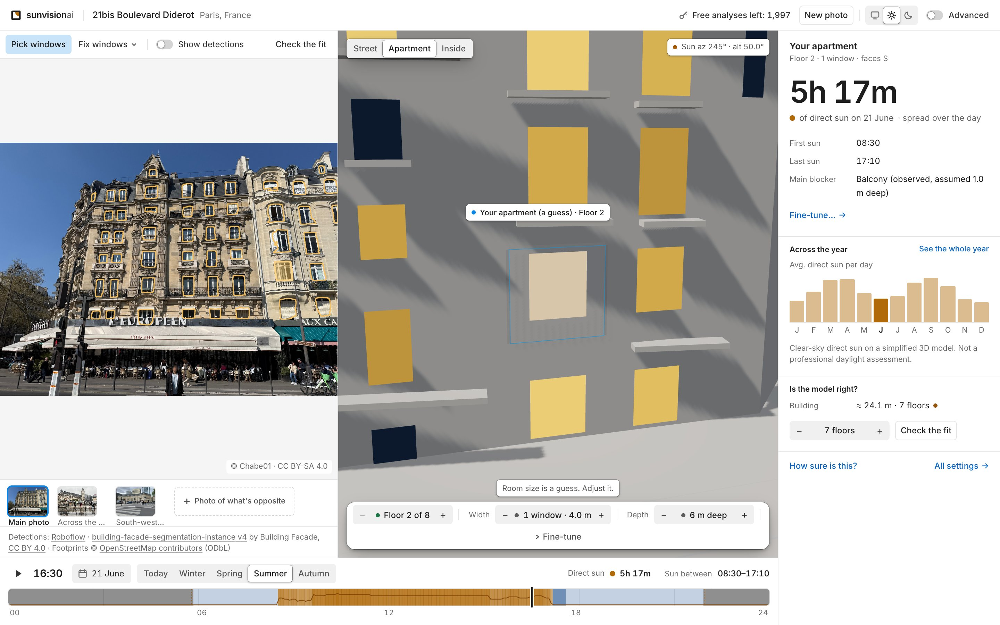
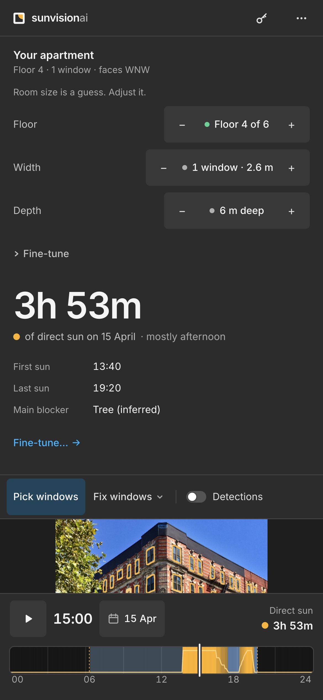
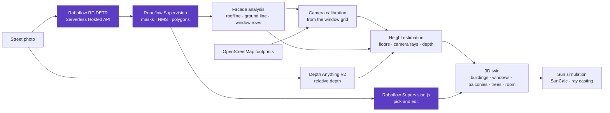

<p align="center"><a href="https://sunvisionai.com"></a></p>
<h1 align="center">sunvision-ai</h1>
<p align="center"><strong>See the sunlight before you move in.</strong><br/>
sunvision-ai segments one street photo with a Roboflow RF-DETR model and turns it into a 3D model of the building and its block. It then simulates the direct sun that reaches any apartment, on any day of the year.</p>

<p align="center">
  <a href="https://sunvisionai.com"></a><br/>
  <a href="https://sunvisionai.com"><strong>Open the live demo at sunvisionai.com</strong></a>: four real buildings, no account and no key needed.
</p>

<p align="center">
  <a href="docs/media/demo.webm"></a><br/>
  <sub><a href="docs/media/demo.webm">Watch the full video</a> (46 s, 1440×900). Playback is sped up. Captions and a cursor were added for the demo.</sub>
</p>

* **Roboflow stack:** a Roboflow Universe model, Roboflow RF-DETR on the Roboflow Serverless Hosted API through the Roboflow Inference SDK, Roboflow Supervision (Python) and Roboflow Supervision.js.
* **Measured:** building heights within 0.4 m of an independent reference in Paris and New York, and +0.32 m against the 3D BAG 70th-percentile roof in Amsterdam ([Results](#results)).
* **Runs without a key:** four examples replay recorded Roboflow responses in the browser. No test calls Roboflow.

## What it does

* **Reads the facade.** A Roboflow RF-DETR segmentation model finds the facade, windows, balcony railings, trees and shopfronts in the photo.
* **Builds a 3D twin.** It combines the detections with OpenStreetMap footprints and a calibrated camera, and measures building heights, floors and window positions in metres.
* **Simulates the sun.** Rays are cast from every window toward the sun for any date and time. You get hours of direct sun, first and last sun, the main blocker and a view of the year.
* **Lets you check every number.** Each value is labelled *observed*, *inferred*, *map*, *assumed* or *manual*, and you can correct any of them by hand.

The four curated examples (Amsterdam, Paris, New York, Sarajevo) need no key and no backend. To analyse your own photo, run the API with a Roboflow key.

## Screenshots


<sub>Advanced mode, New York: detections, 3D twin and inspector. Roboflow detections are drawn with Roboflow Supervision.js. The Building inspector shows 21.3 m fused from 2 methods (OSM reference 21.4 m) and warns that depth set aside windows on a building behind an extra view.</sub>

| Landing page: click a detected window to start | Your own photo: pick the building, choose the side, drag the camera |
|---|---|
|  |  |

| Paris, simple mode: the sun answer for one apartment | Phone |
|---|---|
|  |  |

## How it uses Roboflow

* **Model from Roboflow Universe.** [`building-facade-segmentation-instance/4`](https://universe.roboflow.com/building-facade/building-facade-segmentation-instance) is a Roboflow RF-DETR-Seg 2XL checkpoint trained on 598 facade images (CC BY 4.0). Its 10 classes include `window`, `facade`, `balcony-fence`, `vegetation` and `shop`. Universe reports mAP 0.648, precision 0.737 and recall 0.615. COCO weights have no window class, so the model is used as published, with no fine-tuning. With recall around 0.6 some windows are missed, so the app lets you add or delete them.
* **Roboflow Inference SDK.** [`providers.py`](api/sunvision_cv/providers.py) builds a new `InferenceHTTPClient` for each request, with `api_key_transport="header"`, against the Roboflow Serverless Hosted API (`serverless.roboflow.com`). A visitor's key is used for one request only and never appears in a URL. The same model analyses the main photo and every photo of the surroundings.
* **Roboflow Supervision (Python).** [`processing.py`](api/sunvision_cv/processing.py) calls `sv.Detections.from_inference(..., compact_masks=True)` and applies per-class thresholds. It then runs mask-IoU NMS, an IOS pass that drops windows nested inside other windows, and `mask_to_polygons`. Roboflow `detection_id`s are kept through every filter.
* **Roboflow Supervision.js.** [`PhotoPanel.tsx`](web/src/components/PhotoPanel.tsx) uses one media session per photo. Style resolvers handle selection, hover and confidence, and you can pick and multi-select detections. A selection in 3D is mirrored on the photo. The depth map is drawn with the `depth` annotation renderer.
* **Offline replay.** Every curated photo keeps its raw Roboflow response byte for byte in `data/raw/<id>/roboflow_raw.json`. A replay provider runs the whole pipeline offline from these files.
* **Roboflow Inference (optional).** `uv sync --extra local` lets the API run the same model on your machine with `inference.get_model` (`provider=local`, offered in the manual upload flow; the weights download once with a Roboflow key). `ROBOFLOW_API_URL` can also point at a self-hosted Roboflow Inference server.

**Key handling.** The Roboflow Serverless Hosted API does not send CORS headers to other origins, so the browser always goes through the API. Publishable `rf_` keys only run models in the key owner's workspace, so they cannot run a Universe model for a visitor. Two kinds of key are supported:

* **Bring your own key.** The key is checked in the browser against `api.roboflow.com`, kept in `sessionStorage` (or in `localStorage` if you ask), and sent only in the `X-Roboflow-Key` header. The API never logs, stores or echoes it.
* **Shared key.** It stays on the server. A file-locked ledger caps it per month (`2000` by default) and per client per day (`5`, keyed by a salted IP hash). The ledger does not count 402, 408, 409, 423, 429, 5xx or connection errors, which Roboflow does not bill. Every other status counts, so the cap never under-counts.

Roboflow error statuses map to explicit codes and UI actions. For example, when the shared key runs out, the app asks for a key and retries once a key is saved. The full error table is in [`api/README.md`](api/README.md).

## Results

Each example is rebuilt from its photo, its detections and the OSM footprints, then compared with an independent height reference. The reference is not an input, and nothing was tuned toward it. The New York and Sarajevo cameras were solved from corner points picked by hand in the photo (New York's was then aligned automatically from its window grid). The Amsterdam and Paris cameras start from the photo's geotag and are calibrated automatically. The numbers come from [`examples.test.ts`](web/src/lib/__tests__/examples.test.ts), which writes [`docs/validation-results.json`](docs/validation-results.json).

| Example | Windows detected | Estimated height (plausible range) | Reference | Error |
|---|---|---|---|---|
| Amsterdam, Herengracht 256 | 38 | 19.27 m (19.27–25.17) | 3D BAG lidar: 18.95 m, 70th-percentile roof¹ (ridge 22.29 m, not in the photo) | +0.32 m |
| Paris, 21bis Bd Diderot | 51 | 24.12 m (24.12–29.07) | IGN BD TOPO: 24.5 m (±2.5 m) | −0.38 m |
| New York, 106 Ridge Street | 92 | 21.31 m (20.16–22.75) | OSM (NYC import): 21.4 m | −0.09 m |
| Sarajevo, Obala Kulina bana 24 | 58 | 18.20 m (18.20–23.53) | none (OSM has no height or levels) | n/a |

<sub>¹ From the recorded 3D BAG response; the results JSON stores the ridge reference. See [VALIDATION.md](docs/VALIDATION.md).</sub>

* **The camera matters most.** In Paris, the geotag camera with a pitch guessed by eye (22°) gives 35.35 m (+10.85 m). After the app calibrates the camera from the window grid and ground line, the same detections give 24.12 m (−0.38 m). Part of that −0.38 m is luck: the ground line rests on café awnings.
* **Extra photos measure the surroundings.** Five extra photos of the buildings opposite (two in Amsterdam, two in Paris, one in New York) raise the number of buildings with photo-measured heights from 4 to 8, 2 to 5 and 2 to 3.
* **Three references are not a benchmark.** The ranges are heuristic. Vision measures the top of the visible facade, while references can include roofs. Details and caveats: [VALIDATION.md](docs/VALIDATION.md).

## How it works



1. **Detect.** Roboflow RF-DETR segments each photo, and Roboflow Supervision cleans up the masks. The facade mask gives a roofline and a ground line, and windows are grouped into rows. ([CV pipeline](docs/CV_PIPELINE.md))
2. **Calibrate.** The camera starts from the photo's geotag, from an automatic guess, or from where you place it. It is then refined so that window rows are level, window columns are vertical and the ground line sits at street level. The result is kept only when it clearly improves the fit, and values you set by hand are never moved. You can also drag footprint corners onto the photo. ([reconstruction](docs/RECONSTRUCTION.md))
3. **Measure.** Each photo gives up to three height estimates: floor count × floor height, roofline rays meeting the facade plane, and calibrated depth. They are fused across photos by inverse-variance weighting with heuristic σ. The depth map sets aside roofline samples and windows that belong to a building far behind the facade.
4. **Build.** Footprints are extruded to the measured heights. Windows are projected onto their facade and snapped to the storey grid. The apartment is a room behind the windows you selected.
5. **Simulate.** SunCalc gives the sun's position in the local time zone, with DST. Rays from 12 points on each window are tested against buildings, balconies and trees. The year view runs in a Web Worker. The 3D view and the simulation use the same geometry. ([solar](docs/SOLAR.md))

## Libraries

| Library | Used for | Where |
|---|---|---|
| **Roboflow Universe** | Source of the pretrained facade model (v4) | config: `SUNVISION_FACADE_MODEL` |
| **Roboflow RF-DETR** (RF-DETR-Seg 2XL architecture) | Facade, window, balcony, vegetation and shop segmentation. Run through Roboflow Inference; the `rfdetr` package is not needed. | model `building-facade-segmentation-instance/4` |
| **Roboflow Inference SDK** (`inference-sdk` ≥ 0.30) | Calls to the Roboflow Serverless Hosted API with a key for each request | `api/sunvision_cv/providers.py` |
| **Roboflow Supervision** (`supervision` ≥ 0.25, Python) | Detections, compact masks, NMS, polygons | `api/sunvision_cv/processing.py` |
| **Roboflow Supervision.js** (`supervision` ^0.3.2, npm) | Annotation viewer: masks, boxes, labels, picking, depth overlay | `web/src/components/PhotoPanel.tsx` |
| **Roboflow Inference** (`inference`, optional extra `local`) | Running the facade model on your own machine | `api/sunvision_cv/providers.py` |
| **Roboflow inference-models** (optional, installed separately) | Alternative depth backend (Depth Anything 3), `SUNVISION_DEPTH_PROVIDER=inference-models` | `api/sunvision_cv/depth.py` |
| FastAPI, Uvicorn, python-multipart, Pydantic, python-dotenv | API server | `api/sunvision_cv/app.py` |
| OpenCV, NumPy, Pillow | Polygon simplification, facade geometry, image checks, EXIF stripping | `api/sunvision_cv/` |
| PyTorch, torchvision, Transformers (optional extra `depth`) | Depth Anything V2 Small, run locally | `api/sunvision_cv/depth.py` |
| React 19, Zustand 5, clsx | User interface and state | `web/src/` |
| Three.js 0.187, React Three Fiber 9, drei | 3D twin, shadows, Inside view | `web/src/components/` |
| MapLibre GL 5 (OpenFreeMap tiles) | Map, building picker, footprints for uploads | `web/src/components/` |
| SunCalc, Luxon, tz-lookup | Sun position, local time and DST | `web/src/engine/solar.ts`, `web/src/lib/` |
| exifr | Reading GPS, heading and focal length in the browser | `web/src/components/` |
| Vite 8, TypeScript 5.9, Tailwind CSS 4 | Build and styling | `web/` |
| Vitest 5, pytest, httpx | Tests | `web/`, `api/tests/` |

## Quick start

You need Node 22.12+ or 24+, and [uv](https://docs.astral.sh/uv/). The API runs on Python 3.11 or 3.12; uv downloads one if needed.

```bash
git clone https://github.com/eldarc/sunvision-ai && cd sunvision-ai

# Web app only: the four examples work with no key and no API
(cd web && npm install && npm run dev)             # http://localhost:5173
```

```bash
# Optional: the API, needed to analyse your own photos.
# In a second terminal, from the repository root:
cp .env.example .env                               # set ROBOFLOW_API_KEY, or leave it empty for bring-your-own-key only
cd api && uv sync --extra depth --group dev
uv run uvicorn sunvision_cv.app:app --port 8000    # the Vite dev server proxies /api to it
```

Every variable is described in [`.env.example`](.env.example) and [`api/README.md`](api/README.md). The web app reads only public `VITE_*` values, so the Roboflow key never reaches the browser bundle.

**Tests.** None of the tests call Roboflow. In the API tests the inference client is replaced by a guard or a recording fake.

```bash
(cd web && npm test && npm run typecheck)          # 335 tests in 19 files (Vitest)
(cd api && uv run --group dev pytest -q)           # 101 tests
```

## Repository layout

```text
web/      React + TypeScript app: a static build, with the curated examples in public/examples/
  src/engine/   sun position, ray casting, exposure, annual Web Worker
  src/lib/      camera, alignment, reconstruction, map tiles, Roboflow key and API client
api/      FastAPI service: Roboflow Inference SDK calls, Roboflow Supervision processing, depth, key handling and quota
scripts/  fixture builders: OSM snapshots, replaying recorded inference, camera resection
data/     recorded Roboflow and OSM responses, licences and checksums, camera picks
docs/     architecture, CV pipeline, reconstruction, solar model, validation, data sources
```

## Limitations and next steps

The figures are clear-sky estimates of *potential* direct sunlight on a simplified model. They are not a weather forecast or a professional daylight assessment. Roofs are flat extrusions and the terrain is flat. When a photo has no focal length, the scale rests on an assumed 3.3 m storey (about ±15 %). Analysing your own photo needs the API and a Roboflow key, either your own or the capped shared one; without either, you mark the windows by hand.

Uploaded images are checked for size (15 MB and 40 MP at most), stripped of all EXIF and GPS data, scaled down to 2048 px and never stored. The facade model has no person class.

Next steps, from the roadmap in [LIMITATIONS.md](docs/LIMITATIONS.md):

* A benchmark of a few hundred Commons photos against the 3D BAG, to calibrate the fusion weights.
* A dedicated model with roof and dormer classes, for real roof shapes.
* Sign in with Roboflow (OAuth) once its tokens work for inference, and a reusable Roboflow Supervision.js example for projecting image annotations into 3D.

## Licensing and attribution

* **Code:** Apache-2.0 ([LICENSE](LICENSE)). **Data** is licensed separately: see [DATA_SOURCES.md](docs/DATA_SOURCES.md).
* **Photos** (Wikimedia Commons, also shown in the screenshots and video): Evert100 (CC0), Chabe01 (CC BY-SA 4.0), Andre Carrotflower (CC BY-SA 4.0), Julian Nyča (CC BY-SA 3.0), Jim.henderson (CC BY-SA 4.0) and Benoît Prieur (CC0). The photos were scaled down and their metadata removed. All credits and changes: DATA_SOURCES.md.
* **Facade model:** CC BY 4.0, Roboflow Universe workspace *Building Facade*.
* **Map data:** © OpenStreetMap contributors (ODbL). Basemap © OpenFreeMap / OpenMapTiles.
* **References:** 3D BAG (CC BY 4.0) and IGN BD TOPO (Licence Ouverte 2.0). **Depth:** Depth Anything V2 Small (Apache-2.0).
