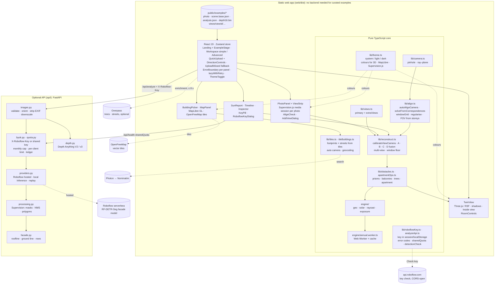

# Architecture

## Principles

* **One contract.** [`web/src/schema/scene.ts`](../web/src/schema/scene.ts) defines images, cameras (with `hfovRange` and `alignment`), extra views (`PhotoView`), detections, footprints, estimates (with provenance), windows, apartments, obstacles and analysis. The Python pipeline emits exactly the `FacadeAnalysis` part of it, for every photo.
* **Python for pixels, TypeScript for geometry.** Inference, mask processing and depth run server-side, once per photo. Camera calibration, height estimation and simulation run in the browser, so manual corrections update everything within a frame.
* **Every photo is a view.** The primary photo and the photos of the surroundings go through the same code (`ViewInput`): per-view camera calibration, per-view methods, per-building fusion.
* **What you see is what is simulated.** `buildGeometry()` produces plain data (`ObstacleScene`, `WindowSpec`). The Three.js view renders it, and the solar engine ray-casts the same objects.
* **Reproducible fixtures.** Raw Roboflow responses (main photos and extra views), OSM responses, the 3D BAG and BD TOPO references, EXIF, Commons API responses and camera-calibration picks are all stored under `data/`. `scripts/` rebuilds every derived file. The public demo never calls an inference service.
* **Replaceable providers.** The inference provider (hosted, local or replay), the depth provider (V2 via transformers, v3 via Roboflow `inference-models`), the geocoders and the Overpass endpoint are all configured through environment variables.
* **Keys stay where they belong.** The shared Roboflow key lives only in the API's environment. A visitor's own key lives only in their browser storage and travels only as the `X-Roboflow-Key` header to our API, plus, when the user clicks *Check key*, as a Bearer header straight to `api.roboflow.com`, which is CORS-open. It goes through our API because Roboflow serverless does not allow browser origins outside `*.roboflow.com` ([`research/byok.md`](research/byok.md)).
* **No database, no auth.** Fixtures are static files. Upload state lives in memory, and Overpass responses are cached in `sessionStorage`. The only server-side state is the quota ledger (a JSON file, written atomically under a file lock).
* **One theme, every renderer.** CSS colours are tokens in [`web/src/index.css`](../web/src/index.css): the dark set in `@theme`, the light overrides under `:root[data-theme="light"]`. [`lib/theme.ts`](../web/src/lib/theme.ts) resolves the preference (`system` follows `prefers-color-scheme`; `light` and `dark` are set with `ThemeToggle` in `components/kit.tsx` and kept in `localStorage` as `sv.theme`), mirrors it onto `<html data-theme>`, and gives the colours that CSS cannot reach (`THEME_COLORS`, `useThemeColors()`) to the Three.js scene, the MapLibre basemap (OpenFreeMap `dark` or `positron`) and the Supervision.js renderer. An inline script in `index.html` applies the same rule before the first paint, so the wrong theme never flashes. `themeContrast.test.ts` checks the WCAG contrast of both token sets.
* **A failing view never blanks the page.** [`components/ErrorBoundary.tsx`](../web/src/components/ErrorBoundary.tsx) wraps the whole app (full-page fallback with *Try again*, *Start over*), the upload step (with *Back to the start*) and each workspace panel (3D view, map, photo, inspector, timeline, sunlight report, day bar, top bar), which falls back to a small *Reload this view* card. The lazily loaded chunks (Workspace, QuickUpload, UploadWizard, TwinView, MapPanel) go through [`lib/lazyWithRetry.tsx`](../web/src/lib/lazyWithRetry.tsx), because React caches a rejected `lazy()` for good: a retry after a failed chunk load fetches it again, and a chunk error also offers *Reload the page*. `TwinView` handles `webglcontextlost` by pausing the 3D view with a *Reload 3D* button and rebuilds the canvas when the context is restored. `crashhunt.test.ts` holds regression tests for render-time exceptions (the second-60 `localToUtc` case, date-input extremes, non-finite geometry).
* **Simple by default.** `uiMode` (`simple` | `advanced`, remembered in `localStorage`) decides which controls are shown; both modes drive the same store and the same simulation.

## Data flow for an upload (quick upload)

1. **Drop.** The browser reads EXIF locally (`exifr`). Before any request is spent, `detectionCheck` (`lib/analyzeApi.ts`) reads `/api/health`: with no key of the user's and a shared key that is disabled, exhausted or absent, the key dialog opens in its *required* variant; an unreachable API is reported as such, because a key would not help. Otherwise `POST /api/analyze` starts at once, in parallel with the next step, unless the user chose to mark windows by hand.
2. **Click the building.** The map loads OpenFreeMap tiles around the photo's GPS position or an address (Photon, then Nominatim). `loadFootprintsFromMap` reads building polygons and streets from the loaded tiles, and `autoCameraForBuilding` stands the camera across the nearest street, facing the facade. *Which side of the building is in your photo?* (`DirectionControls`, with `FacadeArrows` on the map) picks another facade with compass chips (N, NE, E, …; one per facade, up to `SIDE_CHIPS_MAX` = 12) or map arrows (`cameraForSide`), flips to the opposite side, or turns the heading by ±5° (`turnCamera`, which marks the heading *manual*). The user can also drag the camera. If the building is not on the map, *Not on the map? Draw it*; if the automatic camera is wrong, *Place the camera manually ▸* opens the step-by-step placement wizard (`UploadWizard`).
3. **Analyse.** The API validates the image, strips EXIF, picks the key (the visitor's header, or the shared key after reserving a quota slot), runs RF-DETR and Supervision post-processing, then facade analysis and local depth. It returns `FacadeAnalysis`, the depth map, a `privacy` block (`keySource`) and, for shared-key requests, `sharedQuota`. Quota and key errors open the key dialog in its *required* variant, and the analysis re-runs once a key is saved.
4. **Build.** `buildTileScene()` (`lib/tileBuildings.ts`) converts the footprints and streets to ENU around the target centroid and picks the facing edge and visible neighbours. Overpass trees and streets are merged if they arrive within 8 s. `loadScene` then calibrates the camera (pitch, FOV from storeys when there is no focal length, auto-align).
5. **Fallback.** If no API is available or nothing is detected, the user marks windows by hand. No geometry is fabricated.

Extra views follow the same path through *+ Photo of what's opposite* (`AddViewDialog`). The camera is placed on a small plan drawn from the scene's own footprints, so no tiles or Overpass are needed.

## Coordinate conventions

See [coordinates.md](coordinates.md). In short: the world frame is ENU metres around the target building's centroid, using the exact WGS84 geodetic → ECEF → ENU transform (Python and TypeScript share the same check value). Three.js draws everything inside a group rotated −90° about X, so `(e, n, u) → (e, u, −n)`. Headings and azimuths are degrees clockwise from north. Image pixels have their origin at the top left.
